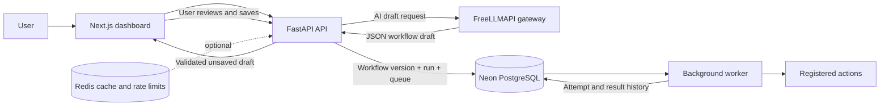

# AgentFlow

AgentFlow is a workflow automation application with an optional AI drafting assistant. Users build a workflow from registered actions, review and save a version, then explicitly start a run. A separate worker executes the saved workflow and records its results. AI proposes editable workflow definitions; it does not write code, save a workflow, approve actions, or run jobs.

## Project structure

```text
AgentFlow/
├── apps/web/                 Next.js and TypeScript dashboard
├── src/agentflow/            FastAPI, workflow rules, actions, and worker
├── migrations/               Alembic PostgreSQL migrations
├── neon/functions/           Optional Neon database health function
├── scripts/                  Local PostgreSQL and service setup
├── tests/                    Backend, browser, and AI proposal checks
├── run.sh                    One-command local development launcher
├── neon.ts                   Neon service configuration
├── pyproject.toml            Python package configuration
└── package.json              Root Neon and build scripts
```

## Architecture and request flow



The project began with deterministic workflow definitions and execution, then added persistence, validation, a durable worker queue, authentication, approvals, and a visual action catalog. AI assistance was added on top of those contracts so generated output must satisfy the same server-side rules as a manually built workflow. See the repository history for the implementation sequence.

### AI proposal flow

1. An authenticated administrator or operator describes a workflow in the builder.
2. The API bounds the prompt and rejects general questions and explicit code/file requests before contacting the model. This intent filter is a heuristic, not a security boundary.
3. AgentFlow builds model instructions from the live registered-action catalog and sends the prompt to the configured FreeLLMAPI gateway. It uses the unified API key with `FREELLMAPI_MODEL=auto`, so routing follows the gateway's enabled providers and fallback chain.
4. The API parses and validates the model's JSON against workflow, action, input, reference, and permission rules. If the response is malformed or invalid, it makes at most one correction attempt with safe validation feedback.
5. The validated definition returns to the visual editor. The user reviews and edits it; saving and running are separate, explicit actions.

The API key stays on the backend. Prompts are sent through FreeLLMAPI to its active upstream provider, so do not include secrets or sensitive personal information. The application works without AI when FreeLLMAPI is unavailable. Local Ollama/Qwen proposals are currently disabled.

## Run locally

Requirements: Python 3.11+, Node.js 20.9+, npm, PostgreSQL, and (optionally) Redis and FreeLLMAPI.

1. Copy `.env.example` to `.env` and `apps/web/.env.example` to `apps/web/.env.local`.
2. Configure `DATABASE_URL` for PostgreSQL. For Neon, use the pooled URL for API/worker traffic and `DATABASE_URL_UNPOOLED` for migrations. Keep both in an ignored environment file or deployment secret store.
3. Configure `FREELLMAPI_API_KEY` in the backend `.env` to enable AI proposals. Keep `FREELLMAPI_MODEL=auto`.
4. Run `./run.sh` at the repository root. The script prepares missing dependencies, starts local services when available, applies migrations, and starts the API, worker, and dashboard.
5. Open <http://localhost:3000>. The API health endpoint is <http://127.0.0.1:8001/health>.

For local PostgreSQL setup, use `scripts/start-local-postgres.sh`. After the database is migrated, create the first administrator with `.venv/bin/python -m agentflow.admin bootstrap-admin`; the command prompts for credentials and does not create a default password. `./run.sh` is a development launcher: it starts Next.js in development mode and binds services to loopback.

FreeLLMAPI is a separate service. Follow its [official installation guide](https://github.com/tashfeenahmed/freellmapi/blob/main/docs/en/install/01-install.md), configure an upstream provider there, then set AgentFlow's unified API key. AgentFlow does not host model weights or expose provider credentials in the browser.

## Data, workflows, and execution

- PostgreSQL is the durable source of truth for users, workflow versions, runs, queue jobs, attempts, approvals, and audit records. Alembic manages schema changes.
- Redis is optional. It caches stable reference data and shares rate-limit counters. Workflow data and queue state remain in PostgreSQL.
- Workflow definitions use a typed, allowlisted action catalog, typed run inputs, and references to earlier step results. Saved edits create immutable versions.
- The API commits a run and its queue row together. The worker claims jobs with expiring leases and persists step/attempt outcomes. A run stays queued when no worker is running.
- Actions that require approval are checked by the worker before execution. AI cannot bypass this gate.

## Security defaults

The current app configuration is deliberately **local-only**. The API host and CORS validators accept loopback addresses/origins, the trusted-host middleware accepts local hosts, and the FreeLLMAPI URL validator accepts a loopback gateway. Session cookies are `HttpOnly`, `Secure`, and `SameSite=Lax`; state-changing browser requests require the configured origin and a session-bound CSRF token. Redis applies shared request limits when available; bounded process-local counters are the fallback.

These defaults mean the current checkout is **not ready to publish as a public website**. Do not expose its API port or put it behind a public proxy without first adding an explicit production configuration for allowed domains, secure cookie/origin handling, trusted proxy behavior, and the private FreeLLMAPI address. The existing eight-character password rule is also weaker than a production password policy.

## Where to deploy

### Recommended target: Render services + Neon PostgreSQL

Render maps well to this app because it supports separate public web services, private services, and persistent background workers. A production layout would be:

| Component | Hosting role |
| --- | --- |
| Next.js dashboard | Render Web Service with HTTPS and the public website domain. |
| FastAPI | Render Web Service for the browser API, or private behind a same-origin Next.js proxy. The current UI calls the API directly, so direct hosting needs exact production CORS and trusted-host configuration. |
| Workflow worker | Render Background Worker running `python -m agentflow.worker`; it must stay up independently of browser requests. |
| Database | Existing Neon PostgreSQL project; pooled connection for runtime and direct/unpooled connection for Alembic migrations. |
| Redis | Managed/private Redis-compatible service for shared rate limits and cache across API instances. |
| FreeLLMAPI | Private service reachable only by the API, or a separately secured host. The current code permits only a loopback gateway URL, so its production network address requires a deliberate config change first. |

Keep services in nearby regions where possible. Store API keys and database URLs in the hosting platform's secret environment settings, never in Git or `NEXT_PUBLIC_*` variables. Run Alembic once as a deployment/pre-deploy step with the direct Neon URL. Test sign-in, an AI proposal, save, run, worker completion, approval behavior, and logs before pointing a domain at the service.

**Why not deploy the whole app to Vercel or Neon Functions as-is?** Vercel is a good Next.js host, but the durable Python worker is a continuously running process and should be deployed as a worker service. Neon supplies the database and optional backend services; the existing FastAPI and Python worker still need a compatible app host. Neon Functions can be considered for a future Node.js API, but replacing this Python execution service would be a separate migration.

### What must change before a public deployment

1. Add a production settings profile that allows the chosen HTTPS domain(s), binds the API to the host's required interface, and keeps trusted-host/CORS checks exact.
2. Decide whether the browser calls a public FastAPI domain directly or uses a same-origin proxy to keep FastAPI private; update the frontend API URL and cookie/CSRF behavior accordingly.
3. Allow the API to reach FreeLLMAPI over private networking with an explicit host allowlist. Do not accept arbitrary gateway URLs from users or prompts.
4. Add production start/build commands or Dockerfiles and a separate worker service definition. Do not use `./run.sh` as the hosted production start command.
5. Configure one-time migrations using Neon’s direct connection, then runtime services with the pooled connection. Keep secrets in the host's secret manager.
6. Review the password policy and verify rate limits use shared Redis when running multiple API instances.

## Checks and operations

```sh
# Python checks
pytest
ruff check src/agentflow tests
ruff format --check src/agentflow tests

# Web checks
cd apps/web
npm run lint
npm run typecheck
npm run format:check
npm run build
npm run test:e2e
```

The backend health endpoint checks database connectivity. The optional Neon Function in `neon.ts` is a separate read-only database health probe; it does not host the main API or worker. Use Neon branches to try schema changes before applying migrations to the production branch.

## Deployment references

- [Render service types](https://render.com/docs/service-types), [private services](https://render.com/docs/private-services), and [private networking](https://render.com/docs/private-network)
- [Render Docker services](https://render.com/docs/docker) and [deploy commands](https://render.com/docs/deploys)
- [Neon connection pooling](https://neon.com/docs/connect/connection-pooling.md) and [Neon Functions](https://neon.com/docs/compute/functions/overview.md)
- [Vercel Functions limits](https://vercel.com/docs/functions/limitations)
